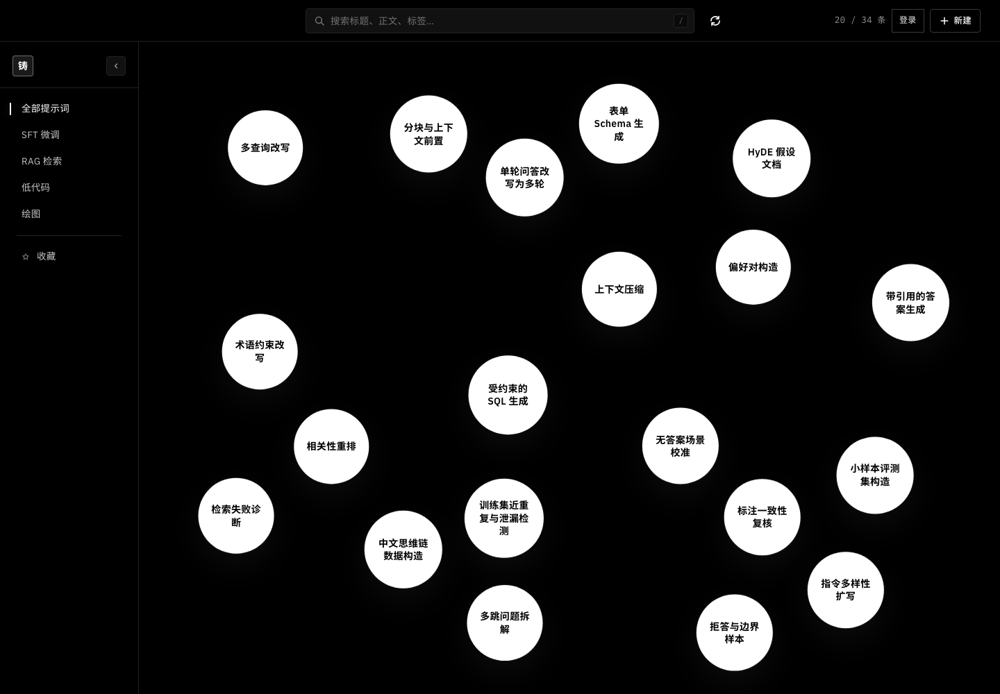
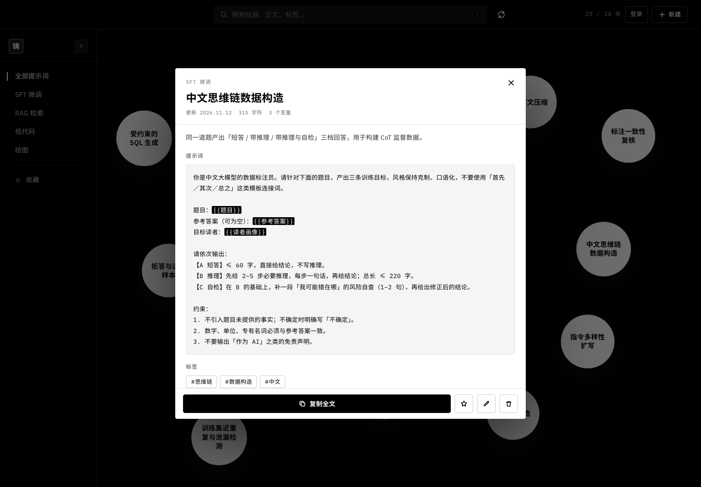
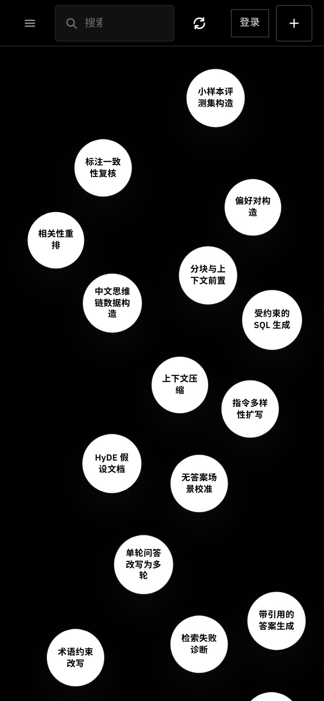
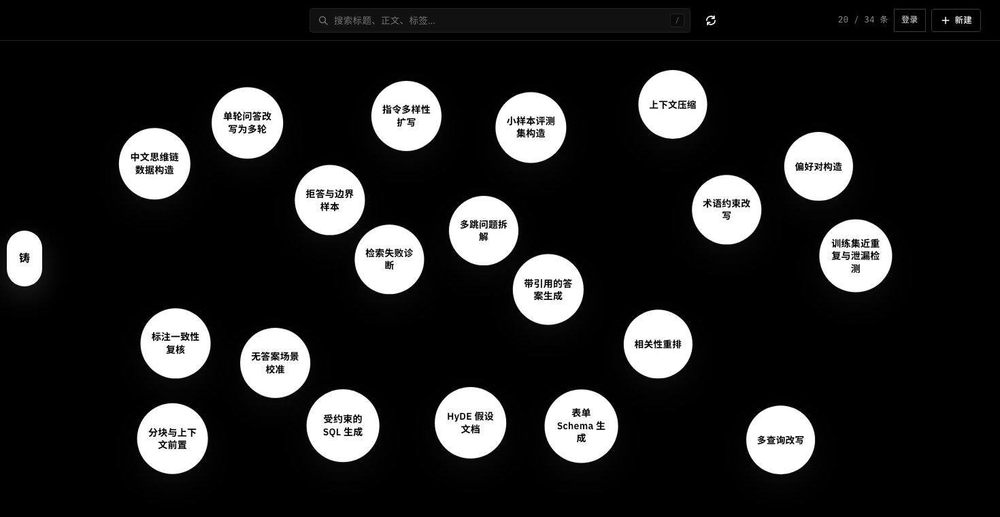
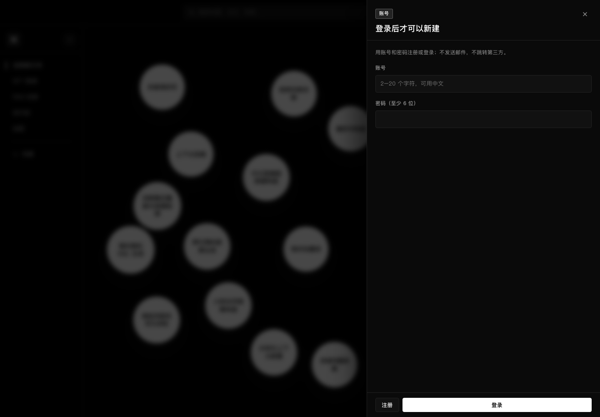

# 铸辞 · PROMPT FOUNDRY

一片纯黑的场，提示词白色圆慢慢漂。圆里只写标题；悬停时圆停住、放大 1.5 倍，点开才是全文。一次显示 20 枚，刷新轮换。

在线：**https://1dadangao.github.io/prompt-foundry/**



## 打开

```bash
# 双击 index.html 即可；或起个本地服务（剪贴板更稳）
cd prompt-foundry && python3 -m http.server 8788
# 访问 http://127.0.0.1:8788
```

推荐 Chrome / Edge / Safari / Firefox 近两年的版本。

## 交互

- **漂浮**：白色圆在星图里缓慢移动，彼此推挤、不叠在一起；靠近边缘会反弹。
- **悬停**：圆立即静止，并在 0.55s 内放大到 1.5 倍；移开继续漂。
- **点击**：从这枚圆本身出发，在 1 秒内扩成一个居中的白色方形框（约半个屏幕），框内全部黑字；复制全文 / 收藏 / 编辑 / 删除在框底。
- **关闭**：0.5 秒缩回原来的圆，星图继续漂。编辑与新建仍走右侧抽屉（新建需先登录）。
- **搜索**：位于页面正中；标题、摘要、正文、标签、分类、来源全字段匹配，多关键词 AND；结果圆会重新排布。
- **20 枚一批**：页面一次只渲染 20 枚圆，顶部显示 `20 / 34 条`；搜索框右侧的双箭头刷新按钮轮换到下一批（相邻两批 6 枚重叠、14 枚新出现）。
- **分类**：左侧字盘按 SFT / RAG / 低代码 / 绘图筛选，也可以只看收藏。
- **标签**：在详情里点标签 → 顶部出现 `#标签 ×`，点它清除筛选。
- **侧栏**：桌面端 200px 字盘，只有「铸」+ 收起「‹」、分隔线、文字导航和收藏；没有分类点/数量/存量条/页脚。点「‹」整栏滑出，左边缘只留白色椭圆「铸」按钮，点它展开；状态记在本机。
- **账号与云端**：顶栏右侧「登录」用站内账号（账号 + 密码）注册/登录；账号信息存 Supabase 云端，不发送邮件、不跳第三方，注册后直接登录。浏览、搜索、复制、收藏无需登录，新建需要登录。新建时可选择只存本机，或提交云端；云端条目先进入待审核，管理员通过后其他人才能看到。
- **纯黑白**：没有彩色强调，所有层级只用明度、字重和 1px 线区分；展开框是白底黑字。
- **分批**：一次 20 枚，刷新轮换；搜索框居中，刷新按钮在它右侧。
- **展开**：点击圆 → 白圆在 1 秒内长成正方形（桌面边长 ≈ min(58vw, 72vh, 720px)，移动端约 88vw），内容随后淡入。

| 键 | 行为 |
|----|------|
| `/` 或 `⌘K` / `Ctrl+K` | 聚焦搜索 |
| `Esc` | 关闭详情 / 收起分类栏 |
| `Enter` / `Space`（圆聚焦时） | 打开详情 |

## 截图

| 展开后 | 移动端 |
|--------|--------|
|  |  |

### 侧栏收起后



### 站内账号



## 文件结构

```
prompt-foundry/
├── index.html          # 结构 + 样式 + 数据 + 漂浮逻辑 + Supabase 登录/云端
├── DESIGN.md           # 设计规范：黑白系统、圆形组件、物理动效、响应式
├── README.md
├── .gitignore          # 排除本机批注 annotations.json
└── screenshots/        # 桌面端 / 详情 / 移动端 / 收起态
```

## 数据

| Key | 内容 |
|-----|------|
| `zhuci.library.v1` | 提示词数组（首次访问写入 34 条示例） |
| `zhuci.favorites.v1` | 收藏的提示词 id 数组 |
| `zhuci.seed.v1` | 示例库版本号 |
| `zhuci.rail.v1` | 侧栏是否收起 |

**云端**：Supabase Auth + Postgres，页面通过 jsDelivr 加载 `supabase-js`。站内账号的「账号」经 SHA-256 映射成内部标识；该标识不接收、不发送邮件，也不在页面出现；密码由 Supabase 哈希保存。登录后新建可选「只存本机 / 提交云端」；云端条目为待审核，管理员通过后进入公共库。管理员由 `profiles.role = 'admin'` 决定，登录后顶栏出现「审核」。前端使用 anon key（设计上可公开），写权限由 Supabase RLS 控制。

> 站内账号即时注册要求 Supabase Auth 的 `mailer_autoconfirm = true`（Dashboard → Authentication → Providers → Email → Confirm email 关闭）。开着时页面会提示，且不会创建未确认账号。

```js
{
  id: 'sft-cot',
  category: 'sft',            // sft | rag | lowcode | image
  title: '中文思维链数据构造',
  summary: '一句话说明',
  tags: ['思维链', '数据构造'],
  body: '……{{变量}}……',
  source: { name: '本站整理', url: '' },
  createdAt: 1762000000000,
  updatedAt: 1762000000000
}
```

- 新建：点顶栏右上角的「+ 新建」（描边按钮）；未登录会先打开登录。正文用 `{{变量名}}` 标记待替换部分，可选择只存本机或提交云端。
- 批量导入：控制台把 JSON 数组写进 `localStorage.setItem('zhuci.library.v1', JSON.stringify(list))` 后刷新。
- 改内置示例：编辑 `index.html` 里的 `RAW_SEED`。
- 恢复示例：库为空时用空状态里的「恢复示例」；或清空 localStorage 的 `zhuci.library.v1` 后刷新。

## 设计

- **只做黑白**：`#000` 背景、`#fff` 圆、其余全部是中性灰阶；没有任何色相（连分类点也是灰的）。
- **星图密度**：圆径按视口面积与条数反算（目标覆盖 ~28%），标题越长圆略大；位置用 best-candidate 采样，随机但不叠。
- **物理**：rAF 驱动，每帧位置积分 + 圆-圆分离 + 边界反弹；悬停的圆变成不可推动的刚体，邻居绕开它。
- **性能**：当前批次 20 个 `translate3d` 元素，单页无 WebGL / 无模糊卡片；`prefers-reduced-motion` 下完全静止。
- **字体**：IBM Plex Sans / IBM Plex Mono + Noto Sans SC；圆内标题按直径缩放（10.5–14px）。

完整规范见 [DESIGN.md](DESIGN.md)。

## 内容来源

内置提示词依据以下公开文档与工程实践整理、改写为中文，并在各条的「来源」中标注：

- [Anthropic — Contextual Retrieval](https://www.anthropic.com/engineering/contextual-retrieval)
- [Anthropic Cookbook — Contextual Embeddings](https://platform.claude.com/cookbook/capabilities-contextual-embeddings-guide)
- [OpenAI — Citation Formatting](https://developers.openai.com/api/docs/guides/citation-formatting)
- [Midjourney — Prompt Basics](https://docs.midjourney.com/hc/en-us/articles/32023408776205-Prompt-Basics)
- [HyDE: Precise Zero-Shot Dense Retrieval](https://arxiv.org/abs/2212.10496)

其余为面向实际工程场景的原创整理。

## 已知限制

- 云端登录/同步依赖 Supabase 网络；站内账号注册要求项目关闭 Supabase 的注册确认开关（`mailer_autoconfirm=true`），否则注册按钮会提示、无法建号。清空浏览器数据仍会丢失本机自定义提示词。
- 悬停放大仅在有指针的设备生效；触摸端直接点开方形框。
- 展开框是正方形且固定居中，长正文在框内滚动；桌面边长最多 720px。
- 移动端星图固定 1100px 高，页面可纵向滚动；当前批次 20 枚圆不保证一屏看完。
- 剪贴板 API 需要安全上下文（`https://` 或 `localhost`）；`file://` 下会降级，个别浏览器仍可能拦截。
- 站点本身不含批注；批注用独立的本地注入工具（`dadangao-dev/serve.py`）完成，不进入本目录代码。
